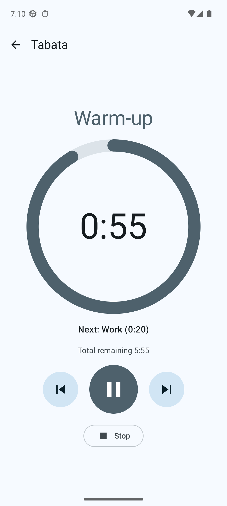
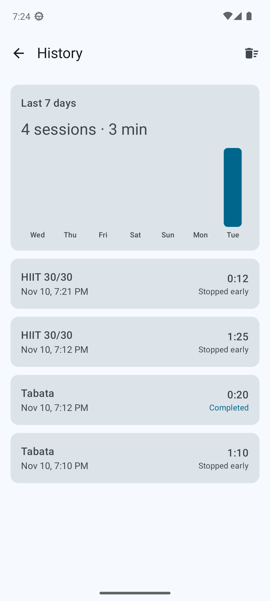

# ⏱️ Intervalo

**Entrena por intervalos sin estar pendiente del móvil** 
*Interval training without keeping an eye on your phone*

  

[Español](#español) · [English](#english)

 &nbsp;  &nbsp;  &nbsp; 

## Español

Intervalo es un temporizador para entrenar por intervalos: Tabata, HIIT, EMOM o tu propia rutina. Le das a empezar, dejas el móvil a un lado y te avisa con sonido y vibración en cada cambio. Sigue contando aunque apagues la pantalla o cambies de app.

### ✨ Qué puedes hacer

- 🏋️ **Crear tus rutinas** con calentamiento, bloques de trabajo y descanso, rondas y vuelta a la calma. Trae tres de ejemplo para empezar: Tabata, HIIT 30/30 y EMOM 10.
- ↕️ **Ordenar los pasos arrastrándolos** con el dedo.
- ⭕ **Seguir el entrenamiento de un vistazo** con un gran anillo de progreso que cambia de color según toque trabajar o descansar.
- 🔔 **Oír y sentir cada cambio** con un pitido y una vibración, y una cuenta atrás de 3 segundos si la quieres.
- 📲 **Controlarlo desde la notificación**: pausar, saltar o parar sin abrir la app.
- 🧩 **Tenerlo en la pantalla de inicio** con un widget para empezar tu última rutina o pausarla.
- 🛡️ **No perder la cuenta**: aunque el sistema cierre la app, el entrenamiento vuelve justo donde iba.
- 📊 **Ver lo que has entrenado** con un historial y un gráfico de los últimos 7 días.

 &nbsp;  &nbsp; 

---

## English

Intervalo is a timer for interval training: Tabata, HIIT, EMOM or your own routine. Hit start, put the phone down, and it tells you with a beep and a buzz every time the phase changes. It keeps counting with the screen off or while you use another app.

### ✨ What you can do

- 🏋️ **Build your routines** with a warm-up, work and rest blocks, rounds and a cool-down. Three examples are included to get going: Tabata, HIIT 30/30 and EMOM 10.
- ↕️ **Reorder steps by dragging** them with your finger.
- ⭕ **Follow the workout at a glance** with a big progress ring that changes colour for work and rest.
- 🔔 **Hear and feel every change** with a beep and a vibration, plus an optional 3-second countdown.
- 📲 **Control it from the notification**: pause, skip or stop without opening the app.
- 🧩 **Keep it on your home screen** with a widget to start your last routine or pause it.
- 🛡️ **Never lose count**: even if the system closes the app, the workout comes back right where it was.
- 📊 **See what you have trained** with a history and a chart of the last 7 days.

---

Parte de mi portfolio de apps Android · Part of my Android app portfolio 
<a href="https://github.com/basd1/bitacora">Bitácora</a> · <a href="https://github.com/basd1/intervalo">Intervalo</a> · <a href="https://github.com/basd1/onda">Onda</a> · <a href="https://github.com/basd1/pixela">Pixela</a> · <a href="https://github.com/basd1/lupa">Lupa</a>

