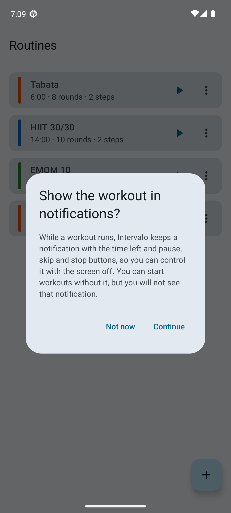
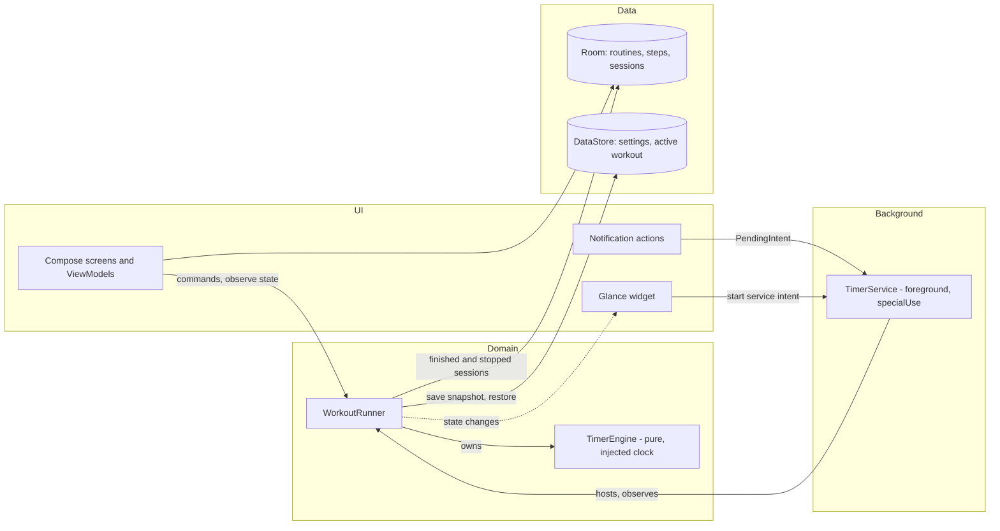
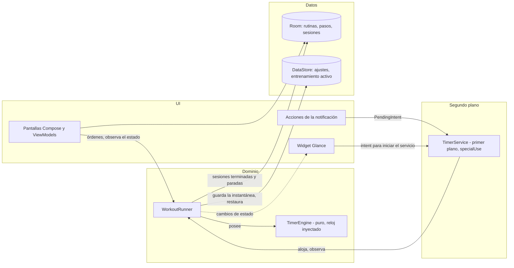

# Intervalo

[English](#english) · [Español](#español)

## English

An interval training timer for Android. Build routines (warm-up, work and rest steps repeated for a number of rounds, cool-down), start one, and it keeps counting with the screen off or the app in the background. You control it from the notification or from a home screen widget, and the history shows what you trained this week.

The point of the project is doing background work properly: a foreground service with the right type, a lifecycle that survives process death, system restrictions (notification permission, wake lock, battery limits) and time that stays exact however long the process is frozen.

100% Kotlin and Jetpack Compose (Material 3), Glance for the widget, Koin for dependency injection.

> **Status:** built, unit-tested (91 tests), linted (no errors) and exercised on an Android API 33 emulator (`portfolio_phone`), including the foreground service, the notification actions, recovery after the process was killed and the widget on the real launcher. It has **not** been run on a physical phone: see [Known limitations](#known-limitations).

### Screenshots

| Routines | Editor (steps reordered by dragging) | Workout |
|---|---|---|
|  |  |  |

| Notification (expanded) | Widget while running | History |
|---|---|---|
|  |  |  |

| Notification permission | Widget picker | Settings |
|---|---|---|
|  |  |  |

More captures (restored workout, paused notification and widget, finished workout) are in [docs/capturas](docs/capturas).

### Features

- **Routines:** list with the computed total duration; create, edit, duplicate, delete. Three samples (Tabata, HIIT 30/30, EMOM 10) are installed on first launch.
- **Editor:** steps of type work or rest, optional labels, rounds, warm-up and cool-down, validation, drag to reorder (and "move up / move down" accessibility actions).
- **Workout screen:** large progress ring drawn on a `Canvas`, current and next phase, colour by phase type, big controls, optional keep-screen-on.
- **Foreground service and notification:** the phase, a native count-down chronometer (the notification is not updated every second) and pause / resume, skip and stop actions. Tapping it opens the workout.
- **Cues:** a beep and a vibration pattern on every phase change and at the end, plus an optional 3-second countdown. All configurable.
- **Recovery:** if the system kills the process, the workout comes back with the time that has really elapsed.
- **Widget (Glance):** the last routine with a Start button, or the current phase, the expected end time and a Pause / Resume button.
- **History:** past sessions and a last-7-days summary with a bar chart.
- English and Spanish.

### Build and run

Requirements: JDK 17, Android SDK with platform 36. Create `local.properties` with your SDK path (it is git-ignored):

```
sdk.dir=C\:\\Users\\<you>\\AppData\\Local\\Android\\Sdk
```

On macOS or Linux use `./gradlew` instead of `.\gradlew.bat`.

```
.\gradlew.bat assembleDebug        # build
.\gradlew.bat testDebugUnitTest    # 91 unit tests (JVM and Robolectric)
.\gradlew.bat lintDebug            # lint
.\gradlew.bat installDebug         # install on the connected device or emulator
```

On Android 13 and later the app asks for the notification permission when you start your first workout. The workout runs either way; without the permission you just do not see its notification.

To put the widget on the home screen: long-press the launcher, choose Widgets, find "Intervalo".

### Architecture

Layers by package: `domain` (models, ports, the timer engine, no Android types), `data` (Room, DataStore, system adapters), `service` (the foreground service and its notification), `widget`, `ui` (Compose screens and ViewModels) and `di` (Koin modules).



#### How time stays exact

`TimerEngine` never counts ticks. Its state is a pure function of the phase plan and four numbers (start instant, accumulated pause, current pause instant, skip offset), all in `elapsedRealtime`:

```
position = (now - start) - pausedTotal + skipOffset      (now is frozen at the pause instant while paused)
```

A ticker only asks the engine to recompute; if the process is frozen for ten minutes, the next tick lands on the right phase and remainder. A test compares thousands of small ticks with one big jump and requires identical states.

#### Process death

`WorkoutRunner` writes a snapshot (a copy of the routine plus those four numbers) to DataStore on every command. Two paths bring the workout back, both rebuilding the engine from the snapshot and the monotonic clock:

1. The service is `START_STICKY`: when the system restarts it without an intent, it calls `runner.restore()`.
2. `MainActivity.onStart` calls `runner.restore()` too, and restarts the service if a workout was running.

`elapsedRealtime` starts from zero after a reboot, so a stored start "in the future" is recognised as a reboot and discarded.

### Decisions

- **Koin instead of Hilt**, part of a portfolio-wide preference for Kotlin-first libraries. `koin-android` and `koin-androidx-compose`, modules in the `di` package, ViewModels with `viewModel { }`. No Hilt or Dagger, no KSP for DI. The editor ViewModel takes its routine id as a Koin parameter.
- **No network layer.** The app is offline. Had it needed one, the choice would have been Ktor client with the CIO engine, not Retrofit or OkHttp.
- **Foreground service type `specialUse`, not `health` or `mediaPlayback`.** `health` is meant for apps that read body sensors or health data and requires matching permissions; this timer reads none. `mediaPlayback` is for audio or video playback the user is consuming; the cues are a few beeps, and declaring a media type to keep a timer alive would misrepresent the app. `specialUse` with a subtype property that states what it is (a user-started workout timer) is the honest fit. The type is only passed to `startForeground` on Android 14+, where it exists.
- **A partial wake lock while the clock runs**, with a timeout of the remaining workout plus a minute as a safety net. A foreground service does not keep the CPU awake, and without it the phase cues would be late with the screen off. Exact alarms per phase were rejected: they need a special permission and add a second source of truth for time.
- **The runner is a process-wide singleton hosted by the service**, not an object owned by the service instance. The service shows the notification, holds the wake lock and routes actions; the workout itself (engine, cues, persistence, history) is plain Kotlin that the JVM tests exercise directly, including recovery.
- **Sessions shorter than 5 seconds are not saved** (accidental starts). Sessions keep working after their routine is deleted: there is no foreign key from `sessions` to `routines`, the routine name is copied.
- **The running workout uses a copy of the routine** (stored in the snapshot), so editing or deleting the routine meanwhile cannot corrupt it.
- **Glance widget:** the content collects a `Flow<WidgetModel>` that only emits when the phase, paused state or last routine changes, so the widget is never redrawn per second. Glance keeps a widget's composition alive for a while, so a one-off snapshot in `provideGlance` would have shown stale data (this was found and fixed during emulator testing). `WidgetUpdater` also calls `updateAll` so a widget whose session ended is redrawn.
- **Drag to reorder is hand-written** (about 50 lines, `ReorderState`) instead of adding a library; it works by item key, and every row also exposes "move up / move down" accessibility actions.
- **Cues with `ToneGenerator` and `Vibrator`**, not `SoundPool`: no audio assets to ship, and the tones are short system beeps.
- **The notification permission is asked once per process**, with an explanation first. Declining does not block the workout.
- **Robolectric runs on SDK 34** (`app/src/test/resources/robolectric.properties`) because SDK 36 needs Java 21 and the project uses JDK 17. The `Application` class is replaced by a plain one in tests so Koin is not started twice.
- **Library versions** and the reasons behind them are listed in [VERSIONES.md](VERSIONES.md).

### Tests

91 unit tests, all on the JVM (Robolectric where Android classes are needed):

- `TimerEngineTest`: plan generation, transitions at exact boundaries, pause and resume without drift, repeated pause cycles, skip and previous, finishing, stop, a three-hour jump, a jump while paused, small ticks vs one jump, rebuilding from a snapshot.
- `WorkoutRunnerTest`: cues (one per phase change, countdown beeps once per second, none while paused), session history, restoration after process death (time follows the clock, paused workouts stay paused, a workout that ended while dead is recorded, reboot is detected).
- `RoutineDaoTest`, `DataStoreStoresTest`: Room and DataStore round trips, step order, cascade delete, sessions outliving routines, unreadable stored data.
- ViewModel tests: editor (validation, reorder, persistence), routines, history, settings.
- `WidgetModelTest`, `WidgetModelsTest`, `WidgetContentTest`: what the widget shows, that it emits only on real changes, and the Glance layout rendered with `glance-appwidget-testing`.

### Known limitations

- **Not tested on a physical device.** In particular: a real 20-minute-plus workout with the screen off and battery saver on (some manufacturers kill services aggressively), and whether sounds and vibration are audible and feel right. The emulator verifies that the service is foreground and the cues are triggered, not how they sound or feel.
- Only API 33 was exercised on an emulator (no run on API 34+, where the `specialUse` type takes effect).
- After the system kills the process, the sticky restart can be refused on Android 12+ when the app may not start a foreground service. The workout is not lost then: it is restored the next time the app is opened. After a device reboot the workout is discarded.
- The widget has one layout (3x2 cells, resizable); it was placed and operated on the emulator launcher only.
- No instrumented (`connectedAndroidTest`) tests: the flows were driven by hand with `adb` and `uiautomator`.
- Phone layout only; no tablet or landscape-specific design.
- No Wear OS app, no Health Connect, no cloud sync, no spoken cues (out of scope).

---

## Español

Un temporizador de entrenamiento por intervalos para Android. Creas rutinas (calentamiento, pasos de trabajo y descanso que se repiten durante varias rondas, vuelta a la calma), inicias una y sigue contando con la pantalla apagada o con la app en segundo plano. Se controla desde la notificación o desde un widget de la pantalla de inicio, y el historial muestra lo que has entrenado esta semana.

El objetivo del proyecto es hacer bien el trabajo en segundo plano: un servicio en primer plano con el tipo correcto, un ciclo de vida que sobrevive a la muerte del proceso, las restricciones del sistema (permiso de notificaciones, wake lock, límites de batería) y un tiempo que sigue siendo exacto por mucho que el proceso esté congelado.

100 % Kotlin y Jetpack Compose (Material 3), Glance para el widget y Koin para la inyección de dependencias.

> **Estado:** compilada, con tests unitarios (91), lint sin errores y probada en un emulador Android API 33 (`portfolio_phone`), incluidos el servicio en primer plano, las acciones de la notificación, la recuperación tras matar el proceso y el widget en el launcher real. **No** se ha ejecutado en un móvil físico: consulta [Limitaciones conocidas](#limitaciones-conocidas).

### Capturas

| Rutinas | Editor (pasos reordenados arrastrando) | Entrenamiento |
|---|---|---|
|  |  |  |

| Notificación (desplegada) | Widget en marcha | Historial |
|---|---|---|
|  |  |  |

| Permiso de notificaciones | Selector de widgets | Ajustes |
|---|---|---|
|  |  |  |

Hay más capturas (entrenamiento restaurado, notificación y widget en pausa, entrenamiento terminado) en [docs/capturas](docs/capturas).

### Funcionalidades

- **Rutinas:** lista con la duración total calculada; crear, editar, duplicar y borrar. En el primer arranque se instalan tres de ejemplo (Tabata, HIIT 30/30, EMOM 10).
- **Editor:** pasos de tipo trabajo o descanso, etiquetas opcionales, rondas, calentamiento y vuelta a la calma, validación y reordenación arrastrando (además de las acciones de accesibilidad "subir / bajar").
- **Pantalla de entrenamiento:** un anillo de progreso grande dibujado en un `Canvas`, la fase actual y la siguiente, color según el tipo de fase, controles grandes y opción de mantener la pantalla encendida.
- **Servicio en primer plano y notificación:** la fase, un cronómetro nativo en cuenta atrás (la notificación no se actualiza cada segundo) y las acciones pausar / reanudar, saltar y parar. Al tocarla se abre el entrenamiento.
- **Avisos:** un pitido y un patrón de vibración en cada cambio de fase y al terminar, más una cuenta atrás opcional de 3 segundos. Todo configurable.
- **Recuperación:** si el sistema mata el proceso, el entrenamiento vuelve con el tiempo que ha pasado de verdad.
- **Widget (Glance):** la última rutina con un botón para empezar, o bien la fase actual, la hora prevista de fin y un botón de pausa / reanudar.
- **Historial:** las sesiones pasadas y un resumen de los últimos 7 días con un gráfico de barras.
- Inglés y español.

### Compilar y ejecutar

Requisitos: JDK 17 y el Android SDK con la plataforma 36. Crea `local.properties` con la ruta de tu SDK (git lo ignora):

```
sdk.dir=C\:\\Users\\<you>\\AppData\\Local\\Android\\Sdk
```

En macOS o Linux usa `./gradlew` en lugar de `.\gradlew.bat`.

```
.\gradlew.bat assembleDebug        # compilar
.\gradlew.bat testDebugUnitTest    # 91 tests unitarios (JVM y Robolectric)
.\gradlew.bat lintDebug            # lint
.\gradlew.bat installDebug         # instalar en el dispositivo o emulador conectado
```

En Android 13 y posteriores la app pide el permiso de notificaciones al empezar el primer entrenamiento. El entrenamiento funciona igual; sin el permiso, simplemente no ves su notificación.

Para poner el widget en la pantalla de inicio: mantén pulsado el launcher, elige Widgets y busca "Intervalo".

### Arquitectura

Capas por paquete: `domain` (modelos, puertos y el motor del temporizador, sin tipos de Android), `data` (Room, DataStore y adaptadores del sistema), `service` (el servicio en primer plano y su notificación), `widget`, `ui` (pantallas Compose y ViewModels) y `di` (módulos de Koin).



#### Cómo se mantiene exacto el tiempo

`TimerEngine` nunca cuenta ticks. Su estado es una función pura del plan de fases y de cuatro números (instante de inicio, pausa acumulada, instante de la pausa actual y desplazamiento por saltos), todos en `elapsedRealtime`:

```
position = (now - start) - pausedTotal + skipOffset      (en pausa, now se queda fijo en el instante de la pausa)
```

Un ticker solo le pide al motor que recalcule; si el proceso está congelado diez minutos, el siguiente tick cae en la fase y el tiempo restante correctos. Un test compara miles de ticks pequeños con un único salto grande y exige estados idénticos.

#### Muerte del proceso

`WorkoutRunner` escribe una instantánea (una copia de la rutina más esos cuatro números) en DataStore con cada orden. Hay dos caminos para recuperar el entrenamiento, y los dos reconstruyen el motor a partir de la instantánea y del reloj monotónico:

1. El servicio es `START_STICKY`: cuando el sistema lo reinicia sin intent, llama a `runner.restore()`.
2. `MainActivity.onStart` también llama a `runner.restore()` y vuelve a arrancar el servicio si había un entrenamiento en marcha.

`elapsedRealtime` empieza desde cero tras reiniciar el dispositivo, así que un inicio guardado "en el futuro" se reconoce como un reinicio y se descarta.

### Decisiones

- **Koin en lugar de Hilt**, dentro de una preferencia común a todo el portfolio por las librerías pensadas para Kotlin. `koin-android` y `koin-androidx-compose`, módulos en el paquete `di` y ViewModels con `viewModel { }`. Sin Hilt ni Dagger, y sin KSP para la inyección. El ViewModel del editor recibe el id de la rutina como parámetro de Koin.
- **Sin capa de red.** La app funciona sin conexión. Si la hubiera necesitado, la elección habría sido el cliente de Ktor con el motor CIO, no Retrofit ni OkHttp.
- **Servicio en primer plano de tipo `specialUse`, no `health` ni `mediaPlayback`.** `health` está pensado para apps que leen sensores corporales o datos de salud y exige los permisos correspondientes; este temporizador no lee ninguno. `mediaPlayback` es para audio o vídeo que el usuario está consumiendo; los avisos son unos pocos pitidos, y declarar un tipo multimedia para mantener vivo un temporizador daría una imagen falsa de la app. `specialUse`, con una propiedad de subtipo que dice lo que es (un temporizador de entrenamiento iniciado por el usuario), es lo que encaja honestamente. El tipo solo se pasa a `startForeground` en Android 14 y posteriores, donde existe.
- **Un wake lock parcial mientras corre el reloj**, con un tiempo límite igual a lo que queda de entrenamiento más un minuto como red de seguridad. Un servicio en primer plano no mantiene la CPU despierta y, sin él, los avisos de fase llegarían tarde con la pantalla apagada. Se descartaron las alarmas exactas por fase: necesitan un permiso especial y añaden una segunda fuente de verdad para el tiempo.
- **El runner es un singleton de proceso alojado por el servicio**, no un objeto que pertenezca a la instancia del servicio. El servicio muestra la notificación, mantiene el wake lock y enruta las acciones; el entrenamiento en sí (motor, avisos, persistencia, historial) es Kotlin puro que los tests de JVM ejercitan directamente, incluida la recuperación.
- **Las sesiones de menos de 5 segundos no se guardan** (inicios accidentales). Las sesiones siguen funcionando aunque se borre su rutina: no hay clave foránea de `sessions` a `routines` y el nombre de la rutina se copia.
- **El entrenamiento en marcha usa una copia de la rutina** (guardada en la instantánea), así que editar o borrar la rutina mientras tanto no puede estropearlo.
- **Widget con Glance:** el contenido recoge un `Flow<WidgetModel>` que solo emite cuando cambian la fase, el estado de pausa o la última rutina, de modo que el widget nunca se redibuja cada segundo. Glance mantiene viva un tiempo la composición del widget, así que una instantánea puntual en `provideGlance` habría mostrado datos viejos (se detectó y se corrigió al probar en el emulador). `WidgetUpdater` llama además a `updateAll` para que se redibuje un widget cuya sesión ha terminado.
- **La reordenación arrastrando está escrita a mano** (unas 50 líneas, `ReorderState`) en lugar de añadir una librería; funciona por clave de elemento, y cada fila expone también las acciones de accesibilidad "subir / bajar".
- **Avisos con `ToneGenerator` y `Vibrator`**, no `SoundPool`: no hay que incluir ficheros de audio y los tonos son pitidos cortos del sistema.
- **El permiso de notificaciones se pide una vez por proceso**, con una explicación previa. Rechazarlo no impide entrenar.
- **Robolectric corre sobre el SDK 34** (`app/src/test/resources/robolectric.properties`) porque el SDK 36 necesita Java 21 y el proyecto usa JDK 17. En los tests, la clase `Application` se sustituye por una simple para que Koin no se arranque dos veces.
- **Las versiones de las librerías** y sus motivos están en [VERSIONES.md](VERSIONES.md).

### Pruebas

91 tests unitarios, todos en la JVM (con Robolectric donde hacen falta clases de Android):

- `TimerEngineTest`: generación del plan, transiciones en los límites exactos, pausa y reanudación sin deriva, ciclos de pausa repetidos, saltar y retroceder, final, parada, un salto de tres horas, un salto estando en pausa, ticks pequeños frente a un salto único y reconstrucción desde una instantánea.
- `WorkoutRunnerTest`: avisos (uno por cambio de fase, pitidos de cuenta atrás una vez por segundo, ninguno en pausa), historial de sesiones y restauración tras la muerte del proceso (el tiempo sigue al reloj, los entrenamientos en pausa siguen en pausa, se registra un entrenamiento que terminó mientras el proceso estaba muerto y se detecta el reinicio del dispositivo).
- `RoutineDaoTest`, `DataStoreStoresTest`: ida y vuelta con Room y DataStore, orden de los pasos, borrado en cascada, sesiones que sobreviven a sus rutinas y datos guardados ilegibles.
- Tests de ViewModels: editor (validación, reordenación, persistencia), rutinas, historial y ajustes.
- `WidgetModelTest`, `WidgetModelsTest`, `WidgetContentTest`: qué muestra el widget, que solo emite con cambios reales y el layout de Glance renderizado con `glance-appwidget-testing`.

### Limitaciones conocidas

- **No probada en un dispositivo físico.** En concreto: un entrenamiento real de más de 20 minutos con la pantalla apagada y el ahorro de batería activado (algunos fabricantes matan los servicios de forma agresiva), y si los sonidos y la vibración se oyen y se notan bien. El emulador comprueba que el servicio está en primer plano y que los avisos se disparan, no cómo suenan ni cómo se sienten.
- Solo se ha probado API 33 en emulador (no se ha ejecutado en API 34 o superior, donde el tipo `specialUse` tiene efecto).
- Después de que el sistema mate el proceso, en Android 12 y posteriores el reinicio sticky puede rechazarse si la app no puede iniciar un servicio en primer plano en ese momento. Aun así el entrenamiento no se pierde: se restaura la próxima vez que se abre la app. Tras reiniciar el dispositivo, el entrenamiento se descarta.
- El widget tiene un solo layout (3x2 celdas, redimensionable); solo se ha colocado y usado en el launcher del emulador.
- No hay tests instrumentados (`connectedAndroidTest`): los flujos se recorrieron a mano con `adb` y `uiautomator`.
- Solo diseño para móvil; no hay un diseño específico para tablet ni para horizontal.
- Sin app para Wear OS, sin Health Connect, sin sincronización en la nube y sin avisos hablados (fuera de alcance).
