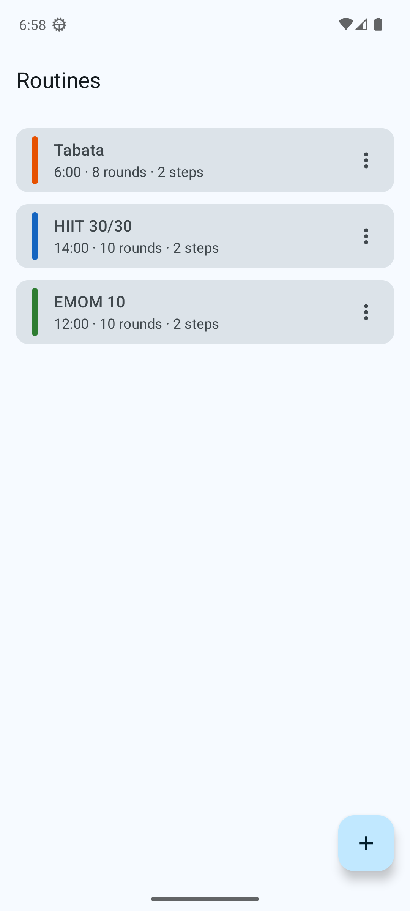
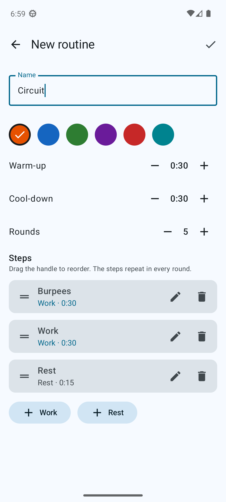
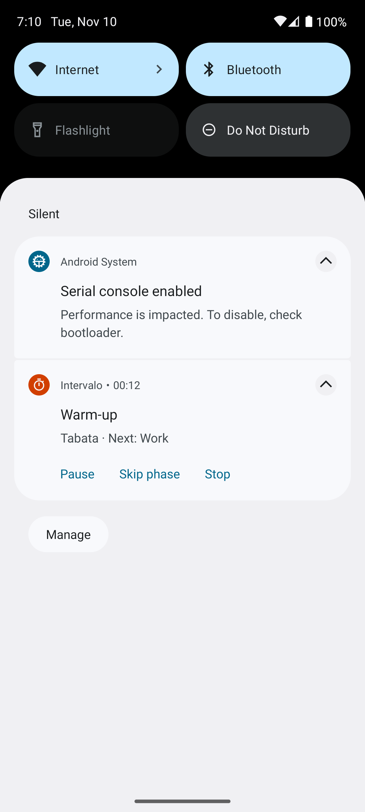
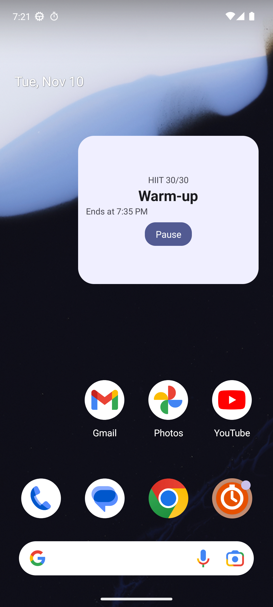
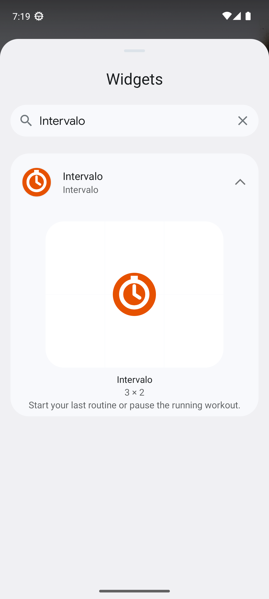
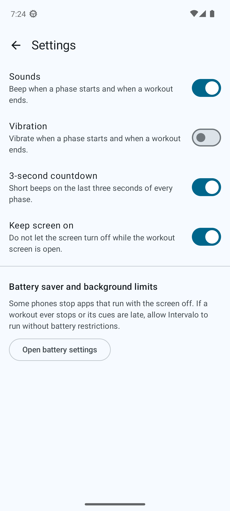
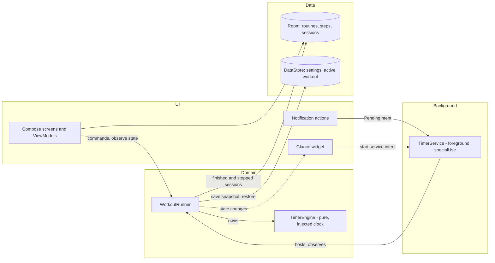

# Intervalo

An interval training timer for Android. Build routines (warm-up, work and rest steps repeated for a number of rounds, cool-down), start one, and it keeps counting with the screen off or the app in the background. You control it from the notification or from a home screen widget, and the history shows what you trained this week.

The point of the project is doing background work properly: a foreground service with the right type, a lifecycle that survives process death, system restrictions (notification permission, wake lock, battery limits) and time that stays exact however long the process is frozen.

100% Kotlin and Jetpack Compose (Material 3), Glance for the widget, Koin for dependency injection.

> **Status:** built, unit-tested (91 tests), linted (no errors) and exercised on an Android API 33 emulator (`portfolio_phone`), including the foreground service, the notification actions, recovery after the process was killed and the widget on the real launcher. It has **not** been run on a physical phone: see [Known limitations](#known-limitations).

## Screenshots

| Routines | Editor (steps reordered by dragging) | Workout |
|---|---|---|
|  |  |  |

| Notification (expanded) | Widget while running | History |
|---|---|---|
|  |  |  |

| Notification permission | Widget picker | Settings |
|---|---|---|
|  |  |  |

More captures (restored workout, paused notification and widget, finished workout) are in [docs/capturas](docs/capturas).

## Features

- **Routines:** list with the computed total duration; create, edit, duplicate, delete. Three samples (Tabata, HIIT 30/30, EMOM 10) are installed on first launch.
- **Editor:** steps of type work or rest, optional labels, rounds, warm-up and cool-down, validation, drag to reorder (and "move up / move down" accessibility actions).
- **Workout screen:** large progress ring drawn on a `Canvas`, current and next phase, colour by phase type, big controls, optional keep-screen-on.
- **Foreground service and notification:** the phase, a native count-down chronometer (the notification is not updated every second) and pause / resume, skip and stop actions. Tapping it opens the workout.
- **Cues:** a beep and a vibration pattern on every phase change and at the end, plus an optional 3-second countdown. All configurable.
- **Recovery:** if the system kills the process, the workout comes back with the time that has really elapsed.
- **Widget (Glance):** the last routine with a Start button, or the current phase, the expected end time and a Pause / Resume button.
- **History:** past sessions and a last-7-days summary with a bar chart.
- English and Spanish.

## Build and run

Requirements: JDK 17, Android SDK with platform 36. Create `local.properties` with your SDK path (it is git-ignored):

```
sdk.dir=C\:\\Users\\<you>\\AppData\\Local\\Android\\Sdk
```

```
.\gradlew.bat assembleDebug        # build
.\gradlew.bat testDebugUnitTest    # 91 unit tests (JVM and Robolectric)
.\gradlew.bat lintDebug            # lint
.\gradlew.bat installDebug         # install on the connected device or emulator
```

On Android 13 and later the app asks for the notification permission when you start your first workout. The workout runs either way; without the permission you just do not see its notification.

To put the widget on the home screen: long-press the launcher, choose Widgets, find "Intervalo".

## Architecture

Layers by package: `domain` (models, ports, the timer engine, no Android types), `data` (Room, DataStore, system adapters), `service` (the foreground service and its notification), `widget`, `ui` (Compose screens and ViewModels) and `di` (Koin modules).



### How time stays exact

`TimerEngine` never counts ticks. Its state is a pure function of the phase plan and four numbers (start instant, accumulated pause, current pause instant, skip offset), all in `elapsedRealtime`:

```
position = (now - start) - pausedTotal + skipOffset      (now is frozen at the pause instant while paused)
```

A ticker only asks the engine to recompute; if the process is frozen for ten minutes, the next tick lands on the right phase and remainder. A test compares thousands of small ticks with one big jump and requires identical states.

### Process death

`WorkoutRunner` writes a snapshot (a copy of the routine plus those four numbers) to DataStore on every command. Two paths bring the workout back, both rebuilding the engine from the snapshot and the monotonic clock:

1. The service is `START_STICKY`: when the system restarts it without an intent, it calls `runner.restore()`.
2. `MainActivity.onStart` calls `runner.restore()` too, and restarts the service if a workout was running.

`elapsedRealtime` starts from zero after a reboot, so a stored start "in the future" is recognised as a reboot and discarded.

## Decisions

- **Koin instead of Hilt** (project-owner override of the guide: Kotlin-first libraries). `koin-android` and `koin-androidx-compose`, modules in the `di` package, ViewModels with `viewModel { }`. No Hilt or Dagger, no KSP for DI. The editor ViewModel takes its routine id as a Koin parameter.
- **No network layer.** The app is offline. Had it needed one, the choice would have been Ktor client with the CIO engine, not Retrofit or OkHttp.
- **Foreground service type `specialUse`, not `health` or `mediaPlayback`.** `health` is meant for apps that read body sensors or health data and requires matching permissions; this timer reads none. `mediaPlayback` is for audio or video playback the user is consuming; the cues are a few beeps, and declaring a media type to keep a timer alive would misrepresent the app. `specialUse` with a subtype property that states what it is (a user-started workout timer) is the honest fit. The type is only passed to `startForeground` on Android 14+, where it exists.
- **A partial wake lock while the clock runs**, with a timeout of the remaining workout plus a minute as a safety net. A foreground service does not keep the CPU awake, and without it the phase cues would be late with the screen off. Exact alarms per phase were rejected: they need a special permission and add a second source of truth for time.
- **The runner is a process-wide singleton hosted by the service**, not an object owned by the service instance. The service shows the notification, holds the wake lock and routes actions; the workout itself (engine, cues, persistence, history) is plain Kotlin that the JVM tests exercise directly, including recovery.
- **Sessions shorter than 5 seconds are not saved** (accidental starts). Sessions keep working after their routine is deleted: there is no foreign key from `sessions` to `routines`, the routine name is copied.
- **The running workout uses a copy of the routine** (stored in the snapshot), so editing or deleting the routine meanwhile cannot corrupt it.
- **Glance widget:** the content collects a `Flow<WidgetModel>` that only emits when the phase, paused state or last routine changes, so the widget is never redrawn per second. Glance keeps a widget's composition alive for a while, so a one-off snapshot in `provideGlance` would have shown stale data (this was found and fixed during emulator testing). `WidgetUpdater` also calls `updateAll` so a widget whose session ended is redrawn.
- **Drag to reorder is hand-written** (about 50 lines, `ReorderState`) instead of adding a library; it works by item key, and every row also exposes "move up / move down" accessibility actions.
- **Cues with `ToneGenerator` and `Vibrator`**, not `SoundPool`: no audio assets to ship, and the tones are short system beeps.
- **The notification permission is asked once per process**, with an explanation first. Declining does not block the workout.
- **Robolectric runs on SDK 34** (`app/src/test/resources/robolectric.properties`) because SDK 36 needs Java 21 and the project uses JDK 17. The `Application` class is replaced by a plain one in tests so Koin is not started twice.
- **Versions** that differ from the guide's tables are listed in [VERSIONES.md](VERSIONES.md).

## Tests

91 unit tests, all on the JVM (Robolectric where Android classes are needed):

- `TimerEngineTest`: plan generation, transitions at exact boundaries, pause and resume without drift, repeated pause cycles, skip and previous, finishing, stop, a three-hour jump, a jump while paused, small ticks vs one jump, rebuilding from a snapshot.
- `WorkoutRunnerTest`: cues (one per phase change, countdown beeps once per second, none while paused), session history, restoration after process death (time follows the clock, paused workouts stay paused, a workout that ended while dead is recorded, reboot is detected).
- `RoutineDaoTest`, `DataStoreStoresTest`: Room and DataStore round trips, step order, cascade delete, sessions outliving routines, unreadable stored data.
- ViewModel tests: editor (validation, reorder, persistence), routines, history, settings.
- `WidgetModelTest`, `WidgetModelsTest`, `WidgetContentTest`: what the widget shows, that it emits only on real changes, and the Glance layout rendered with `glance-appwidget-testing`.

## Known limitations

- **Not tested on a physical device.** In particular: a real 20-minute-plus workout with the screen off and battery saver on (some manufacturers kill services aggressively), and whether sounds and vibration are audible and feel right. The emulator verifies that the service is foreground and the cues are triggered, not how they sound or feel.
- Only API 33 was exercised on an emulator (no run on API 34+, where the `specialUse` type takes effect).
- After the system kills the process, the sticky restart can be refused on Android 12+ when the app may not start a foreground service. The workout is not lost then: it is restored the next time the app is opened. After a device reboot the workout is discarded.
- The widget has one layout (3x2 cells, resizable); it was placed and operated on the emulator launcher only.
- No instrumented (`connectedAndroidTest`) tests: the flows were driven by hand with `adb` and `uiautomator`.
- Phone layout only; no tablet or landscape-specific design.
- No Wear OS app, no Health Connect, no cloud sync, no spoken cues (out of scope).
